# EXNO2DS
# AIM:
      To perform Exploratory Data Analysis on the given data set.
      
# EXPLANATION:
  The primary aim with exploratory analysis is to examine the data for distribution, outliers and anomalies to direct specific testing of your hypothesis.
  
# ALGORITHM:
STEP 1: Import the required packages to perform Data Cleansing,Removing Outliers and Exploratory Data Analysis.

STEP 2: Replace the null value using any one of the method from mode,median and mean based on the dataset available.

STEP 3: Use boxplot method to analyze the outliers of the given dataset.

STEP 4: Remove the outliers using Inter Quantile Range method.

STEP 5: Use Countplot method to analyze in a graphical method for categorical data.

STEP 6: Use displot method to represent the univariate distribution of data.

STEP 7: Use cross tabulation method to quantitatively analyze the relationship between multiple variables.

STEP 8: Use heatmap method of representation to show relationships between two variables, one plotted on each axis.

## CODING AND OUTPUT

## Supermarket.csv 

```
import pandas as pd
import numpy as np
import matplotlib.pyplot as plt
import seaborn as sns
from google.colab import files

uploaded = files.upload()
df = pd.read_csv(next(iter(uploaded)))

print(df.head())
print(df.info())
print(df.isnull().sum())

for col in df.columns:
    if df[col].isnull().sum() > 0:
        if df[col].dtype == 'object':
            df[col] = df[col].fillna(df[col].mode()[0])
        else:
            df[col] = df[col].fillna(df[col].median())

print(df.isnull().sum())

num_cols = df.select_dtypes(include=np.number).columns

plt.figure(figsize=(12, 6))
sns.boxplot(data=df[num_cols])
plt.xticks(rotation=45)
plt.title("Boxplot Analysis")
plt.tight_layout()
plt.show()

Q1 = df[num_cols].quantile(0.25)
Q3 = df[num_cols].quantile(0.75)
IQR = Q3 - Q1

df_clean = df[~((df[num_cols] < (Q1 - 1.5 * IQR)) |
                 (df[num_cols] > (Q3 + 1.5 * IQR))).any(axis=1)]

print("Original Dataset:", df.shape)
print("After Outlier Removal:", df_clean.shape)

cat_cols = df.select_dtypes(include='object').columns

for col in cat_cols:
    if df[col].nunique() <= 15:
        plt.figure(figsize=(8, 4))
        sns.countplot(data=df, x=col)
        plt.xticks(rotation=45)
        plt.title("Countplot of " + col)
        plt.tight_layout()
        plt.show()

for col in num_cols:
    sns.displot(data=df, x=col, kde=True)
    plt.title("Distribution of " + col)
    plt.show()

print(pd.crosstab(df['Gender'], df['Product line']))
print(pd.crosstab(df['Customer type'], df['Payment']))

plt.figure(figsize=(10, 6))
sns.heatmap(df.select_dtypes(include=np.number).corr(),
             annot=True, cmap='coolwarm', fmt='.2f')
plt.title("Correlation Heatmap")
plt.show()

print(df_clean.head())
df_clean.to_csv("supermarket_cleaned.csv", index=False)
files.download("supermarket_cleaned.csv")
```

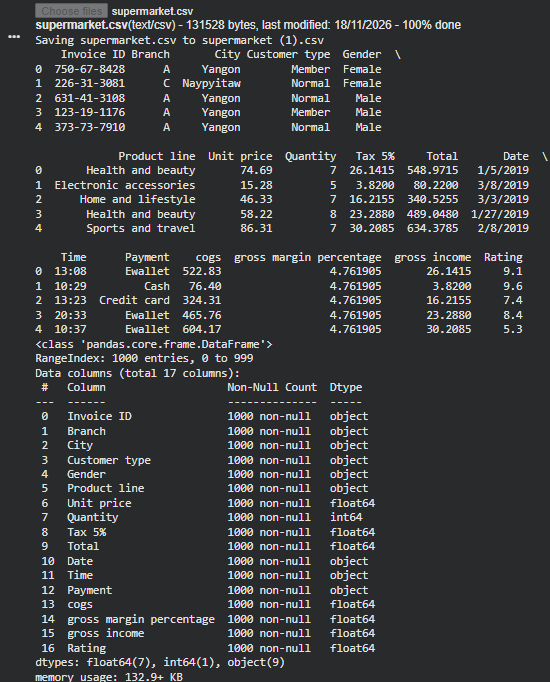

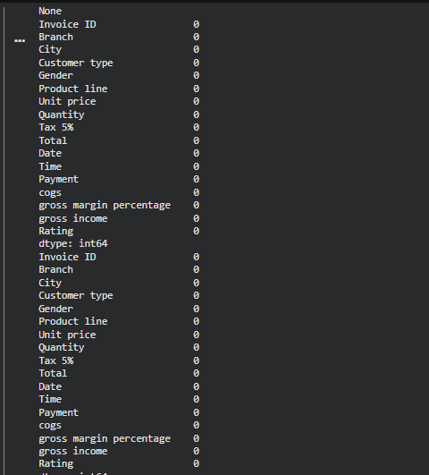

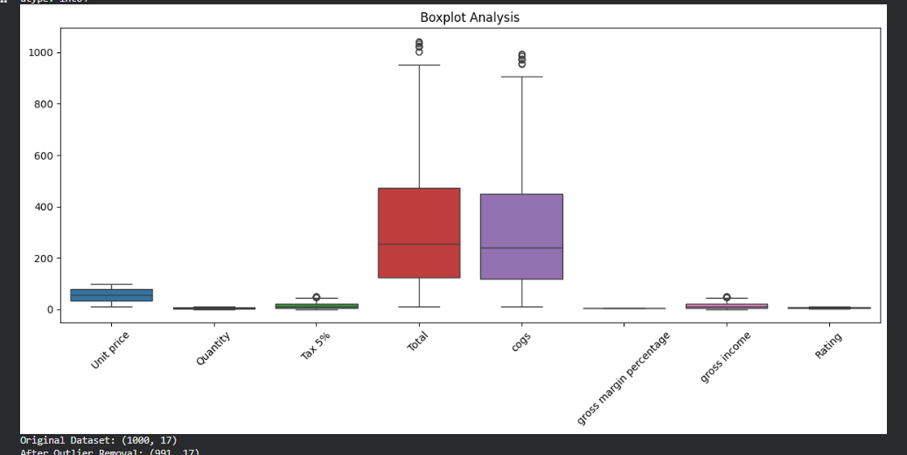

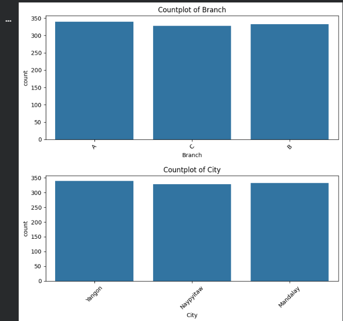

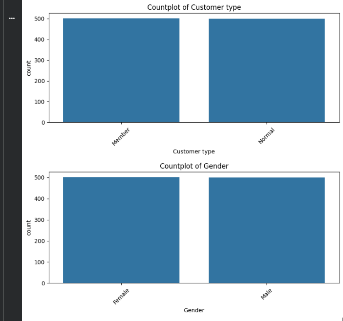

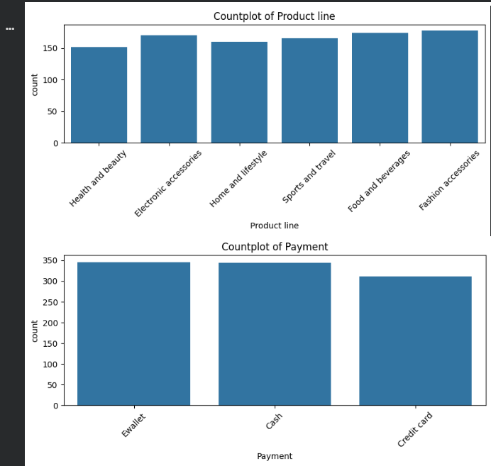

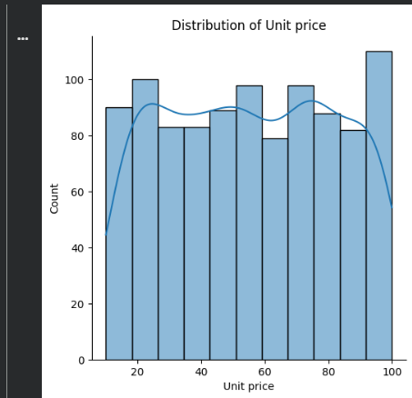

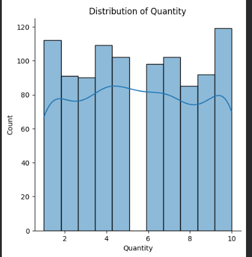

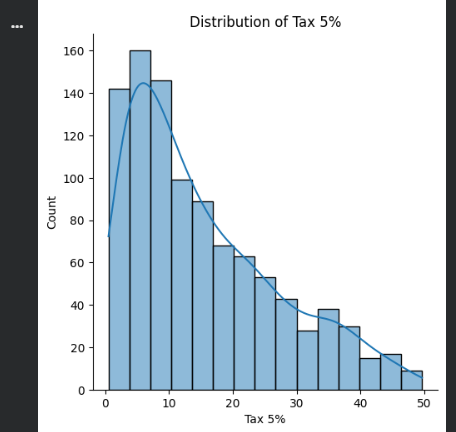

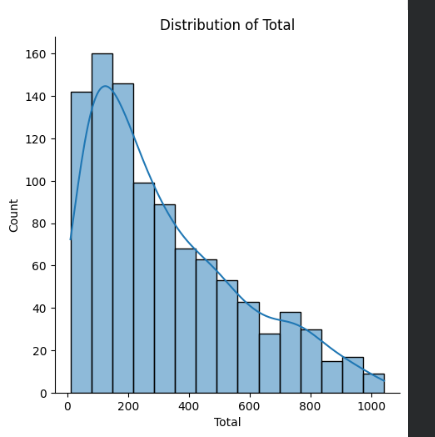

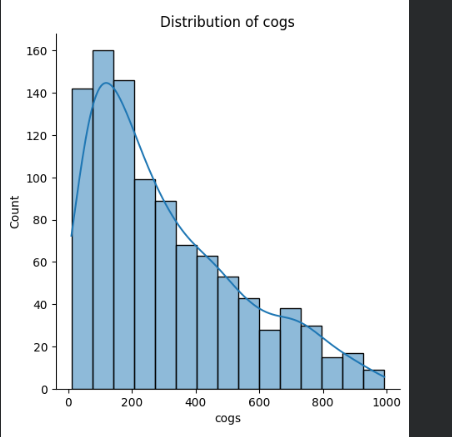

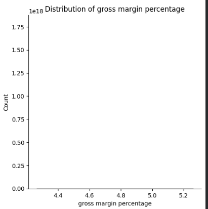

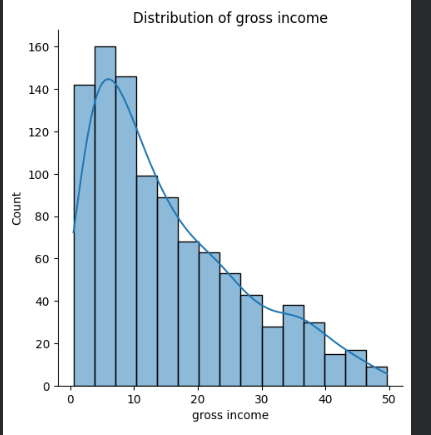

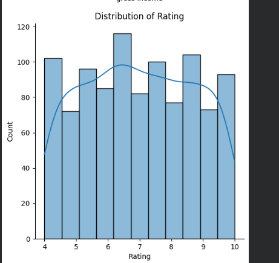

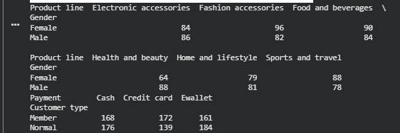

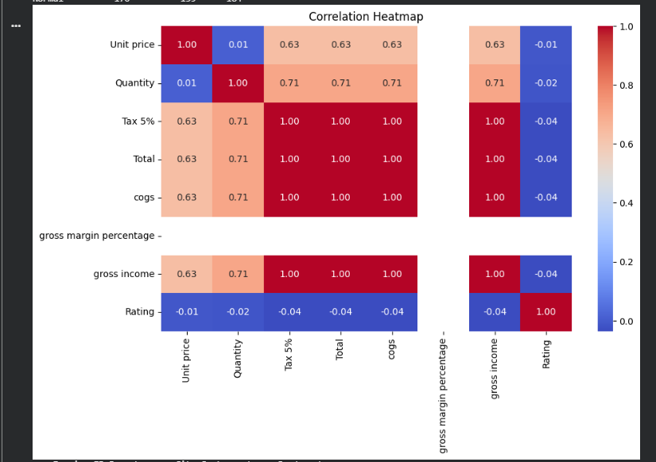


## titanic_dataset.csv 

```
import pandas as pd
import numpy as np
import matplotlib.pyplot as plt
import seaborn as sns
from google.colab import files

uploaded = files.upload()
df = pd.read_csv(next(iter(uploaded)))

print(df.head())
print(df.info())
print(df.isnull().sum())

for col in df.columns:
    if df[col].isnull().sum() > 0:
        if df[col].dtype == 'object':
            df[col] = df[col].fillna(df[col].mode()[0])
        else:
            df[col] = df[col].fillna(df[col].median())

print(df.isnull().sum())

num_cols = df.select_dtypes(include=np.number).columns
num_cols = [col for col in num_cols if col != 'PassengerId']

plt.figure(figsize=(12, 6))
sns.boxplot(data=df[num_cols])
plt.xticks(rotation=45)
plt.title("Boxplot Analysis")
plt.tight_layout()
plt.show()

Q1 = df[num_cols].quantile(0.25)
Q3 = df[num_cols].quantile(0.75)
IQR = Q3 - Q1

df_clean = df[~((df[num_cols] < (Q1 - 1.5 * IQR)) |
                 (df[num_cols] > (Q3 + 1.5 * IQR))).any(axis=1)]

print("Original Dataset:", df.shape)
print("After Outlier Removal:", df_clean.shape)

cat_cols = df.select_dtypes(include='object').columns

for col in cat_cols:
    if df[col].nunique() <= 15:
        plt.figure(figsize=(8, 4))
        sns.countplot(data=df, x=col)
        plt.xticks(rotation=45)
        plt.title("Countplot of " + col)
        plt.tight_layout()
        plt.show()

for col in ['Survived', 'Pclass']:
    plt.figure(figsize=(8, 4))
    sns.countplot(data=df, x=col)
    plt.title("Countplot of " + col)
    plt.show()

for col in num_cols:
    sns.displot(data=df, x=col, kde=True)
    plt.title("Distribution of " + col)
    plt.show()

print(pd.crosstab(df['Sex'], df['Survived']))
print(pd.crosstab(df['Pclass'], df['Survived']))

plt.figure(figsize=(10, 6))
sns.heatmap(df.select_dtypes(include=np.number).corr(),
             annot=True, cmap='coolwarm', fmt='.2f')
plt.title("Correlation Heatmap")
plt.show()

print(df_clean.head())
df_clean.to_csv("titanic_cleaned.csv", index=False)
files.download("titanic_cleaned.csv")
```

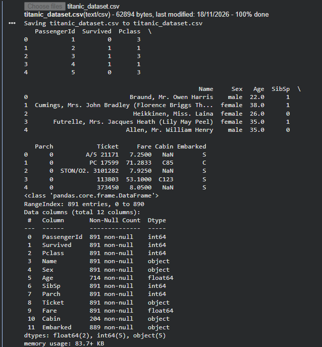

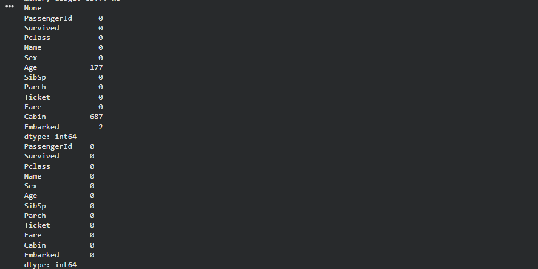

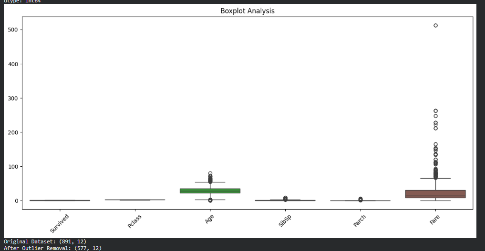

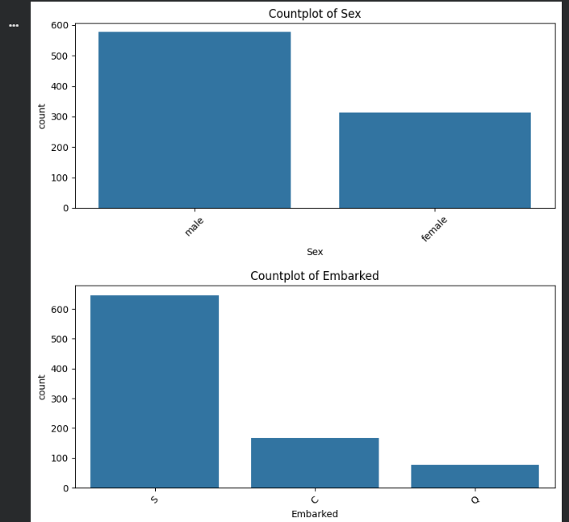

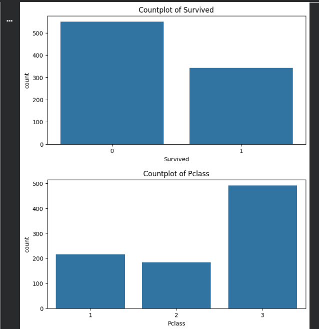

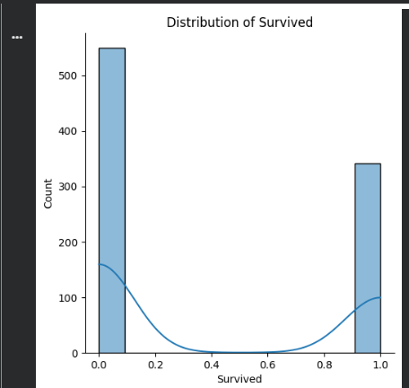

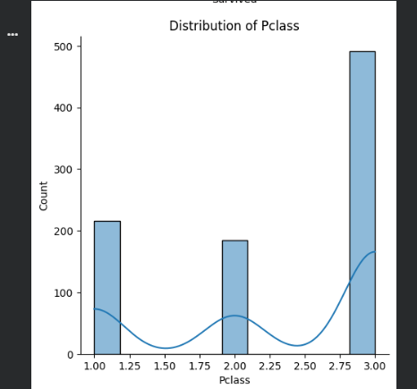

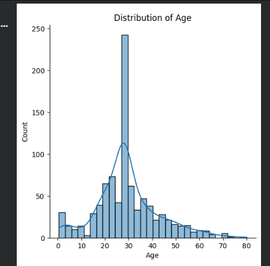

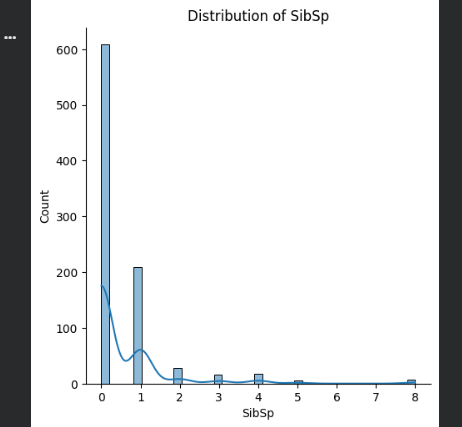

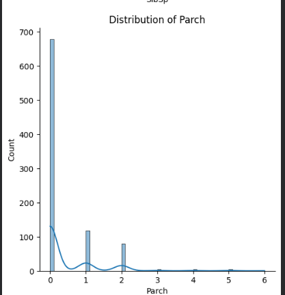

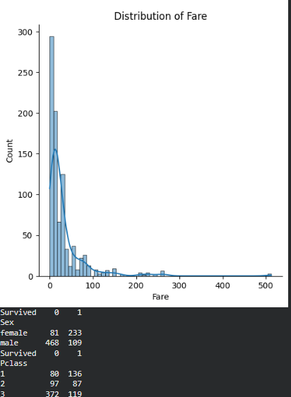

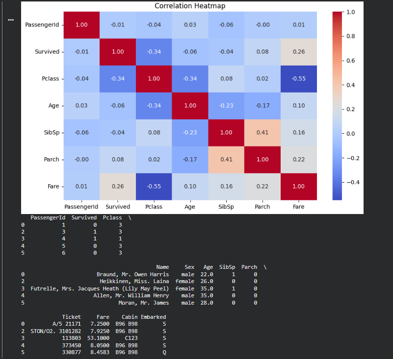

# RESULT

The datasets were successfully cleaned by handling missing values and removing outliers using the IQR method. Exploratory Data Analysis was performed using boxplots, countplots, displots, cross-tabulation, and heatmaps.

# SUMMARY 

In this experiment, I learned how to perform data cleaning and exploratory data analysis using Python, Pandas, and Seaborn. The datasets were imported using `pd.read_csv()` and analyzed to identify missing values and numerical and categorical features.

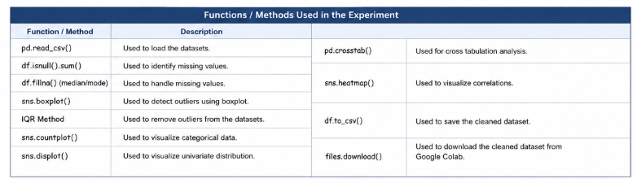

Missing values were handled using median and mode. The Boxplot method was used to analyze outliers, and the IQR (Interquartile Range) method was applied to remove outliers from the datasets.

Countplot was used to visualize categorical data, while Displot represented the univariate distribution of numerical data. Cross-tabulation was used to analyze relationships between categorical variables, and Heatmap was used to visualize correlations between numerical variables.

Finally, the cleaned datasets were saved using `df.to_csv()` and downloaded using Google Colab's `files.download()` function.

**Pandas:** Data loading, cleaning, manipulation, and saving datasets. Seaborn & Matplotlib: Boxplot, Countplot, Displot, and Heatmap visualization. Google Colab Files: Uploading and downloading datasets.
